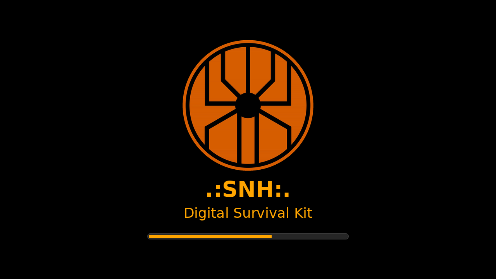
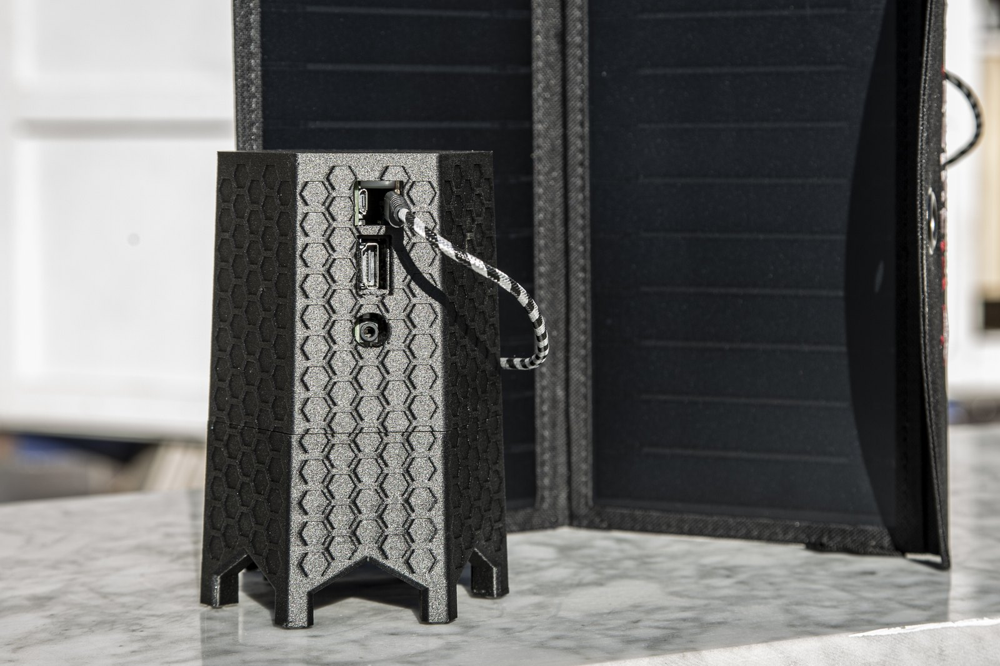
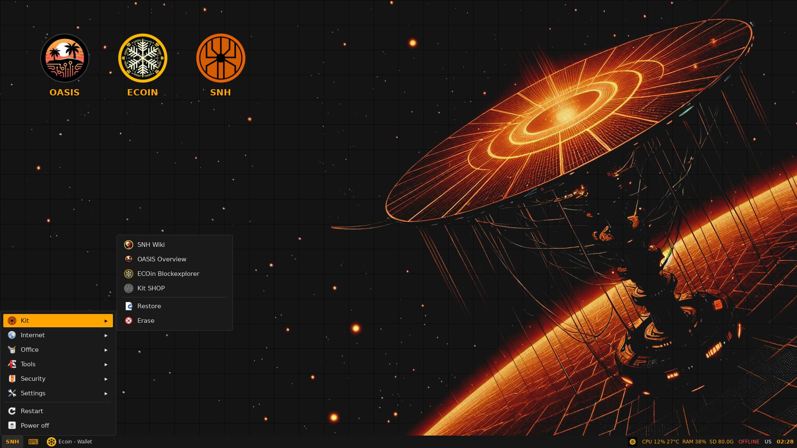

# SolarNET.HuB - Operating System



SNH-OS is the operating system of the [SolarNET.HuB](https://solarnethub.com) kit, a solar-powered Raspberry Pi built as a digital survival kit. It starts straight into a desktop with [OASIS](https://wiki.solarnethub.com/socialnet/overview) and [ECOin](https://ecoin.03c8.net) running, and sends everything that leaves for the internet through Tor.

Each release is one image file that you copy to a microSD card. Get it from [Releases](../../releases/latest).



## What is inside

| | |
|---|---|
| **SNH software** | OASIS 1.4.3, the project's social network. ECOin 0.7.5.8, its wallet. Both start with the kit |
| **Privacy** | Tor 0.4.9 for every connection, Privoxy, and a firewall that lets no program go around Tor |
| **Internet** | Firefox ESR 153 with uBlock Origin and DuckDuckGo. Thunderbird 153 for mail, with OpenPGP |
| **Office** | LibreOffice Writer and AbiWord 3.0 word processors, Gnumeric 1.12 spreadsheet, qpdfview PDF reader, calculator |
| **Tools** | Thunar file manager, Ristretto image viewer, VLC media player, text editor, archive manager, terminal, GnuPG, git |
| **Hardware** | Wired network, WiFi, Bluetooth, sound over HDMI, USB disks, on-screen keyboard |
| **Base** | Read-only system built with the Yocto Project 6.0 LTS and Linux 6.12, with a Debian 12 desktop |

It carries nothing else: no games, no programs you did not ask for, no background services.

## Buy it built

The complete kit, assembled and with SNH-OS already on its card, is at the shop: [shop.solarnethub.com](https://shop.solarnethub.com).

## DIY. What you need

- A Raspberry Pi 3 Model B. The image is built for the 64-bit boards (3B, 3B+, 4, 400, 5 and Zero 2 W), but it has only been tested on the 3B.
- A microSD card of 16 GB or more. With 32 GB or more OASIS keeps a larger cache.
- A power supply that really delivers 5 V and 2.5 A. With a weak one the bar at the bottom of the screen shows a low voltage warning.
- A screen with HDMI, and a mouse. A keyboard is optional: there is one on screen.

## Download

Get these two files from the [latest release](../../releases/latest):

- `snh-os-v.1.0.img.xz`, the image
- `snh-os-v.1.0.img.xz.sha256`, its checksum

Check the download before using it. On Linux and macOS, from the folder that holds both files:

```
sha256sum -c snh-os-v.1.0.img.xz.sha256
```

On Windows, in PowerShell, compare the result of this command with the content of the `.sha256` file:

```
Get-FileHash snh-os-v.1.0.img.xz -Algorithm SHA256
```

## Copy it to the card

Everything on the card is erased.

### With Raspberry Pi Imager (Windows, macOS, Linux)

1. Install [Raspberry Pi Imager](https://www.raspberrypi.com/software/) and insert the card.
2. In "Operating System" choose "Use custom" and select `snh-os-v.1.0.img.xz`. There is no need to decompress it.
3. In "Storage" choose the card.
4. If it offers to apply OS customisation settings, answer "No". They only work with Raspberry Pi OS.
5. Write, wait for the verification to finish and take the card out.

[balenaEtcher](https://etcher.balena.io) works the same way: select the file, select the card, flash.

### From a Linux terminal

Find the device name of the card with `lsblk` before and after inserting it. Writing to the wrong device destroys its content.

```
xz -dc snh-os-v.1.0.img.xz | sudo dd of=/dev/sdX bs=4M conv=fsync status=progress
```

## First start

Put the card in the Pi, connect the screen and the mouse, and plug in the power.

- While it starts, the screen shows the SNH logo and a progress bar, as in the picture at the top.
- The first start takes a little longer, because the kit prepares the rest of the card to store your data.
- A dialog asks for your language (English or Spanish), keyboard layout and time zone. You can change them later.
- OASIS and ECOin start by themselves. ECOin needs a while to catch up with its network.
- Connect to the internet with a network cable, or to a WiFi network from the menu: SNH, Settings, Network.

## The desktop

OASIS and ECOin are on the main screen. Everything else is in the SNH menu, at the bottom left.



Shut the kit down from that menu before unplugging it, and eject USB disks from it before removing them.

## Privacy

- Every connection to the internet goes through Tor, for all programs. No program can go around it.
- Name resolution (DNS) also goes through Tor.
- Connections to your own local network are direct, so the kit can reach other devices at home.
- The only connection to the internet that does not use Tor is the clock synchronisation (NTP), because Tor does not work with a wrong clock.
- IPv6 is disabled.
- The kit accepts no connections from the internet. From the local network it only answers to OASIS, so that it can synchronise with other OASIS devices nearby.
- Firefox comes with uBlock Origin, HTTPS-only mode, strict tracking protection and DuckDuckGo as search engine, and without telemetry.
- No logs are kept.

## Your data

The system itself is read-only and never changes. Your identity, wallet, keys, files and settings are stored apart, on the rest of the card.

The Kit menu offers two options, and both work without internet:

- **Restore** resets the desktop and the application settings. It keeps your OASIS identity and data, your ECOin wallet, your keys and your folders.
- **Erase** leaves the kit as new. The OASIS identity, the ECOin wallet, the saved WiFi networks and all your files are lost.

Copying a new image to the card also erases everything. Before doing it, copy what you want to keep to a USB disk: your folders, the OASIS data (`.ssb`), the ECOin wallet (`.ecoin/wallet.dat`) and your keys (`.gnupg`). They are hidden folders in your home folder; show them in Files with Ctrl+H.

## Updates

OASIS checks for new versions by itself and is updated from its own settings.

A new version of the system is a new image in this repository. To install it, copy it to the card as described above.

## Help

- Documentation: [wiki.solarnethub.com](https://wiki.solarnethub.com)
- The kit, its parts and how to build one: [solarnethub.com](https://solarnethub.com)

## Licenses

SNH-OS is made of free software, each part under its own license; the license of every package ships inside the image, under `/usr/share/doc`. OASIS and ECOin are developed by the project: see [code.solarnethub.com](https://code.solarnethub.com) for their code and licenses.
